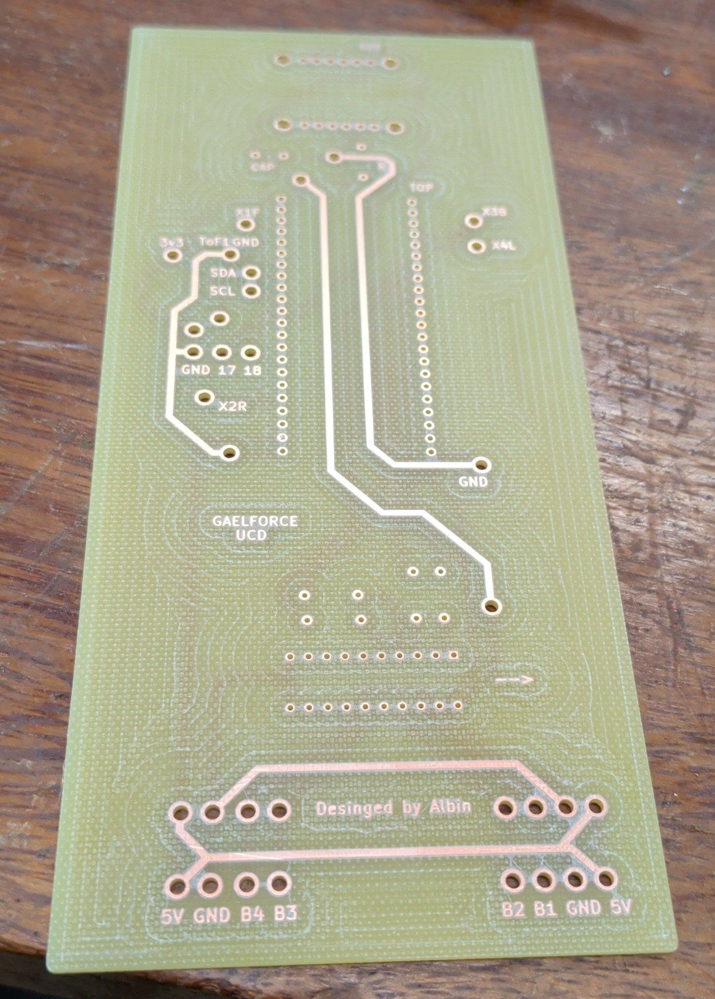
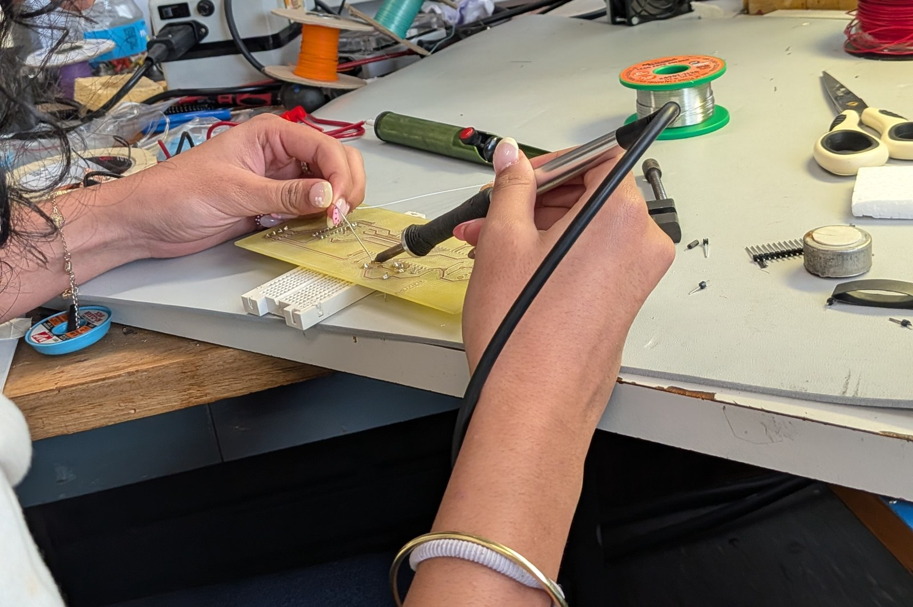
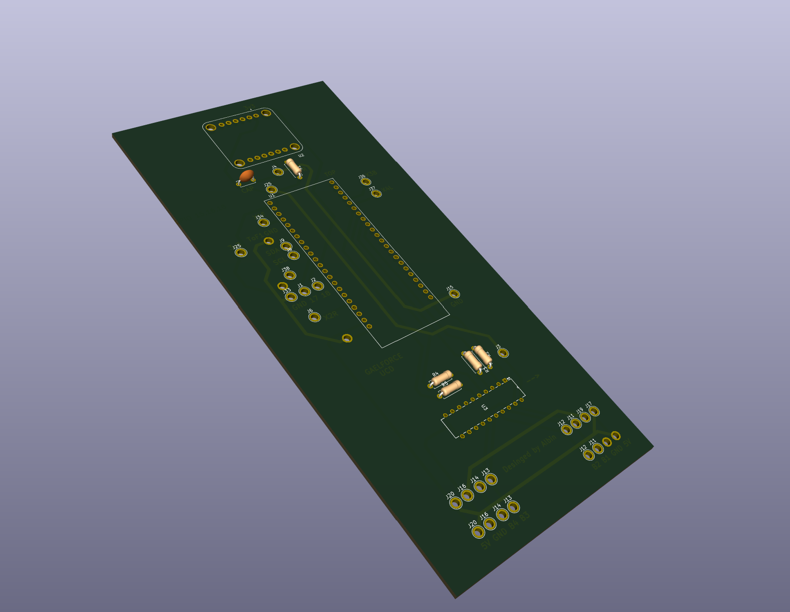
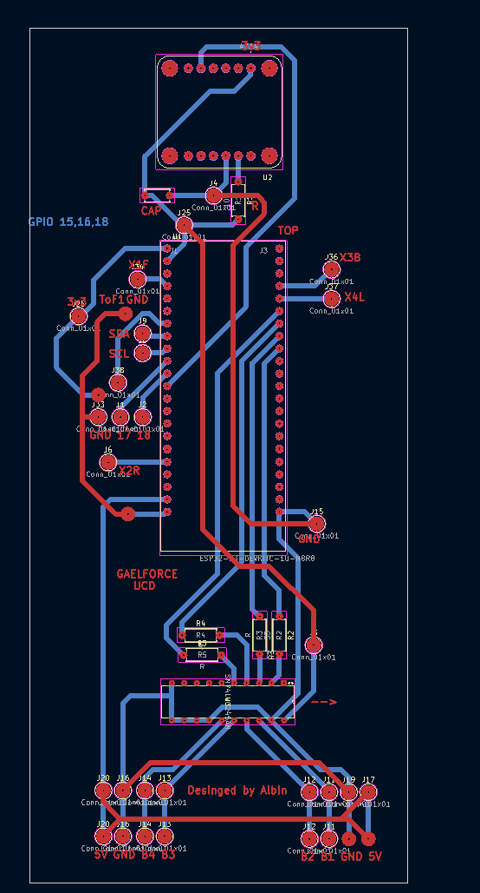
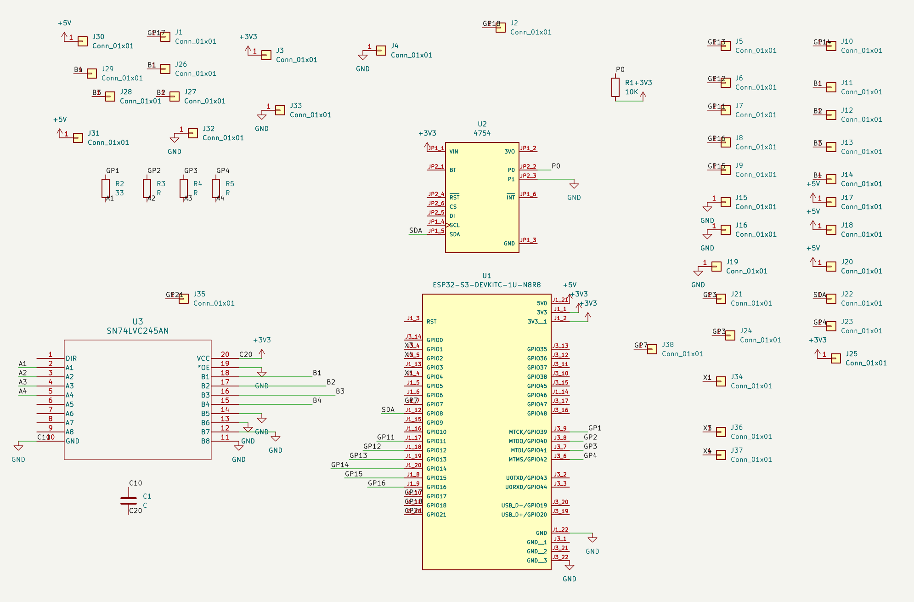

# PCB V2

V2 was meant to fix what went wrong with V1. It has two changes: a fixed IMU ground, and a pin map that follows where the cables leave the board. Bench testing on 12 October showed that V2 has its own layout mistakes, listed under [What went wrong](#what-went-wrong).

## What changed

**The IMU ground.** On V1, the ground trace for the IMU was on the top layer when it should have been on the bottom. V2 was meant to have it on the bottom layer. Testing showed that this fix did not work: on the built V2 board the IMU has no ground connection at all (see below).

**The pins.** V1 kept the breadboard's pin numbers, which left the encoder and ToF cables scattered around the board. V2 regroups the pins so each set of cables leaves from one place. Eight pins moved. Everything else is the same.

| Signal | V1 GPIO | V2 GPIO | Why |
|---|---|---|---|
| Vertical encoder A | 1 | **40** | Encoders grouped on four adjacent header pins |
| Vertical encoder B | 2 | **42** | |
| Horizontal encoder A | 3 | **39** | |
| Horizontal encoder B | 4 | **41** | |
| ToF enable, front | 11 | **4** | Uses a pin the encoders freed up |
| ToF enable, rear | 14 | **1** | Uses a pin the encoders freed up |
| ToF enable, left | 13 | **2** | Uses a pin the encoders freed up |
| RS-485 DE/RE | 21 | **7** | Nearest free pin that is not a strapping pin |

These stay the same: the IMU receive pin on GPIO 8, RS-485 TX and RX on 17 and 18, I²C SDA and SCL on 16 and 15, and the right ToF enable on 12.

The level converter's B pins are also wired to make the cabling easier. B1 and B2 carry the encoders' B channels, and B3 and B4 carry their A channels. If an encoder counts backwards, the firmware has a reverse flag for each one, so the wiring does not need to change.

The full write-up of every move, with the reason for each, is in [`PIN_CHANGES.md`](../code/pcb-v2/PIN_CHANGES.md), and the V2 wiring tables are in the [firmware README](../code/pcb-v2/README.md).

## The V2 firmware

The V2 firmware is the V1 firmware with the new pin numbers in `include/pod_config.hpp`, plus the later ToF mask-order fix and bench test. It is in [`code/pcb-v2/`](../code/pcb-v2/), at commit `986a2f3` of `ODOM-CODE`.

V1 and V2 firmware are not interchangeable. GPIO 1, 2 and 4 were encoder inputs on V1 and are ToF enable outputs on V2, so flashing the wrong firmware drives the wrong wire. Flash V2 firmware only on a V2 board.

## Status

The V2 board right after it came off the machine at the Elecworkshop.

Soldering the V2 board with Selma. The board was soldered and finished, then tested on 12 October. It does not work yet. The three problems below have to be fixed first, and the fixes are planned for the Wednesday team meeting.

## What went wrong

Debugging the V2 board took about two hours. The pin map did its job, but the board has three layout mistakes.

**1. The IMU ground does not exist.** The ground connection for the IMU is missing from the board. V1 had this ground on the wrong layer, and the V2 change did not fix it. Without a ground, the IMU cannot work.

**2. The ground for ToF sensors 1 and 3 is on the wrong layer.** The ground for these two sensors is on the wrong layer, which is the same kind of mistake as the V1 IMU ground. The wire to ToF 3 also broke during testing, so it has to be re-done as part of the fix.

**3. Encoder B does not have enough through holes.** The Encoder B connections need more through holes than the board has.

## What it taught us

All three faults are layer and connection mistakes that the layout looked right for, and none of them is a pin-map problem. V1 had one such mistake (the IMU ground on the wrong layer) and V2 has three, including that same ground again. Checking each ground net against the layers in the board editor, and checking every net for a complete connection, should be done before the next set of Gerbers is sent.

## Design files

A 3D render of the V2 board from KiCad. The board is long and narrow. The IMU breakout is at the top, the ESP32-S3 is in the middle, and the four resistors and the level converter are below it. The ESP32-S3 and the IMU show only as outlines, because their 3D models are not in the project.

The V2 board layout, from the KiCad PCB editor. Front copper is red and back copper is blue. Traces run from the ESP32-S3 pins and the level converter to the single-pin connectors at the bottom and along the sides. Click the image for the PDF.

The V2 schematic. It has the ESP32-S3 dev board, the IMU breakout, the level converter and four resistors, and a single-pin connector for each off-board wire. Click the image for the PDF.

- [Schematic (PDF)](../hardware/v2/ODOM-V2-schematic.pdf)
- [PCB layout (PDF)](../hardware/v2/ODOM-V2-pcb-layout.pdf)
- [Gerbers and drill files](../hardware/v2/gerbers.zip), as sent to the board maker. The [job file](../hardware/v2/ODOM%20V2-job.gbrjob) is next to it.
- [KiCad project folder](../hardware/v2/): the schematic, board file, project file and custom symbol and footprint libraries.
